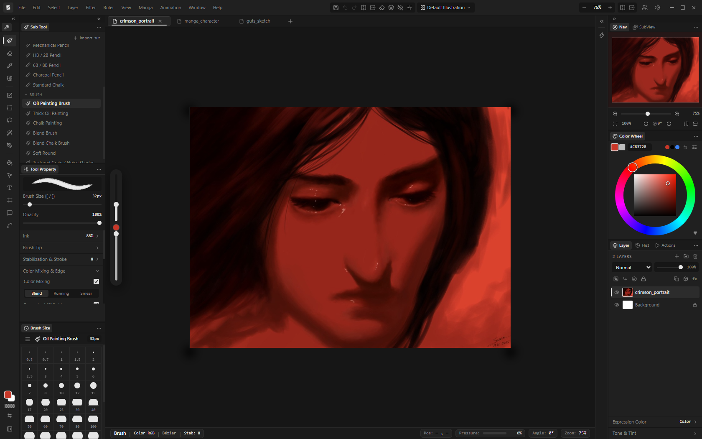
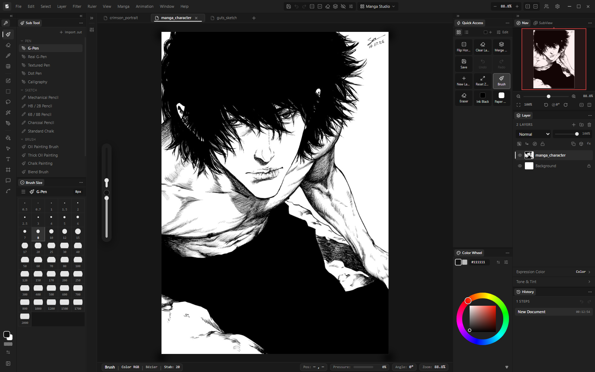
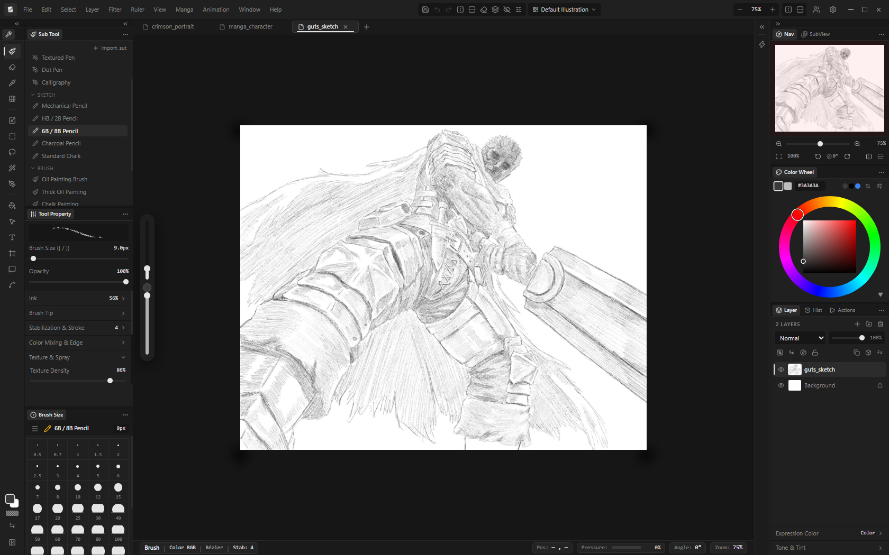
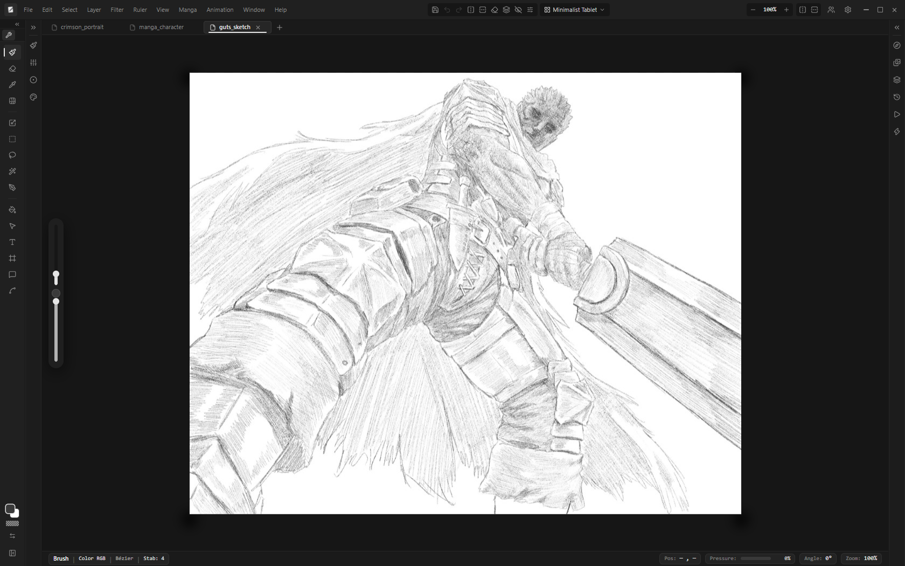
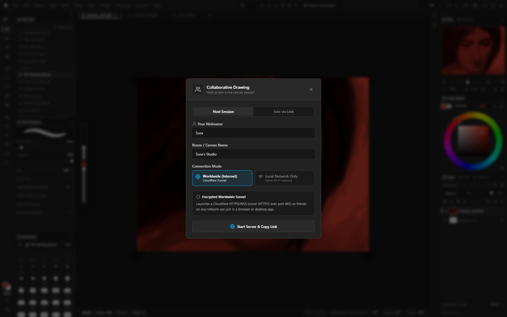
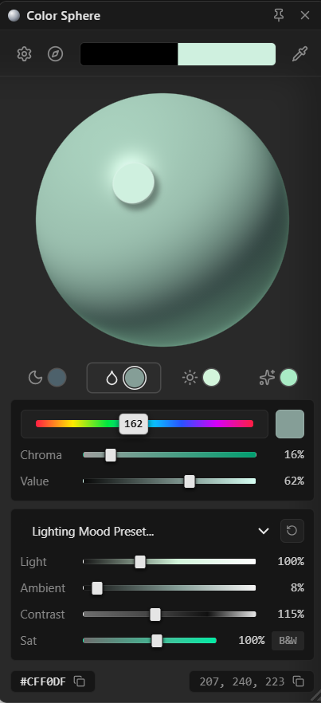

# Ink Studio

Desktop digital painting, illustration, and manga application with real-time multiplayer collaboration, built with Tauri, React, TypeScript, and Rust.

[Website](https://praisesora.github.io/inkstudio/) · [Releases](https://github.com/praisesora/inkstudio/releases) · [Latest Download](https://github.com/praisesora/inkstudio/releases/latest) · [Changelog](./CHANGELOG.md) · [Discord](https://discord.gg/37dYhgBePe) · [Issues](https://github.com/praisesora/inkstudio/issues) · [Privacy](./PRIVACY.md) · [License](./LICENSE)



## Download

Download the latest build from the [Ink Studio website](https://praisesora.github.io/inkstudio/) or the [Releases](https://github.com/praisesora/inkstudio/releases) page. Prebuilt Windows installers include automatic in-app updates; macOS and Linux binaries can be built from source using the instructions below.

## Features

- **Brush Engine, Natural Paint & Brush Studio**:
  - WebGL-accelerated brush engine supporting pressure, tilt, twist, velocity, taper, dual brush tips, paper textures, wet edges, stroke stabilization, custom pressure curves, and native Windows **Wintab** & **Windows Ink** stylus input in Rust over binary IPC.
  - **Natural Paint & Impasto Engine**: dual-channel (RGBA + paint heightmap) continuous bristle ribbon rendering, physical canvas-tooth valley-fill and dry-brush interaction across 4 grain mapping modes, 3D impasto micro-relief shading, watercolor granulation, and painterly color mixing.
  - **Brush Studio**: dedicated 8-tab brush editor with a live scratchpad (`Shape & Bristles`, `Stroke & Taper`, `Texture & Grain`, `Dual Brush`, `Natural Paint`, `Impasto & Wet`, `Sensor Matrix`, `About & Presets`). Ships with built-in Pen, Sketch, Brush, and Natural Paint presets, supports `.inkb` brush import/export, and imports Clip Studio Paint `.sut` brushes.
- **Drawing, Retouch, Vector & Selection Tools**:
  - **Gradient Tool (`Shift+G`)**: Linear, Radial, and interactive bicubic Mesh Gradients with multi-stop RGBA editing, presets, repeat/reflect modes, blend modes, and 4×4 Bayer dithering.
  - **Retouch Tool (`S`)**: Smudge (premultiplied pickup + Finger Painting), Blur, Dodge, Burn (Shadows/Midtones/Highlights + Protect Tones), and Clone Stamp (`Alt+Click` origin, aligned mode, active or all-visible sampling).
  - **Bézier Pen (`P`) & Vector Layers**: true cubic Bézier curves with interactive anchor/tangent handles, symmetry breaking (`Alt+Drag`), de Casteljau curve splitting, closed fills, plus vector pinch, line-width, and simplify editing (`Y`).
  - **Geometric Shapes (`U`)**: lines, rectangles, rounded rectangles, ellipses, triangles, polygons, stars, and arrows with stroke, fill, and dash controls.
  - **Selections, Transform & Multi-Layer Liquify**: Rectangle, Lasso, and Magic Wand tools with a unified selection bar, Cut/Copy/Paste, Move to New Layer (`Ctrl+Shift+J`), Delete Section, Delete Outside Section, Free Transform, Mesh Warp, and **Multi-layer Liquify (`J`)**.
- **Layers, Color & Compositing**:
  - Sparse-tile raster layers, vector layers, folders, clipping masks, non-destructive layer masks, GPU layer styles (stroke, drop shadow, outer glow), **all 28 blend modes** with lossless PSD/PSB round-trip, adjustment layers (Curves, Levels, Gradient Map, Color Balance), tonal corrections, filters (Gaussian Blur, Motion Blur, Unsharp Mask, Film Grain), and Color / Grayscale / 1-bit Monochrome expression modes.
  - **3D Sphere Color Picker**: interactive lit 3D color sphere alongside the Color Wheel and Color Sliders, featuring painterly shadow, base, highlight, and rim lighting slots, lighting mood presets, B&W value preview, and **Pin / Unpin** support to detach into a draggable, resizable floating palette.
  - Drag and drop image files directly from File Explorer into the canvas or Layers panel.
- **Manga, Rulers & Webtoon**:
  - Frame border folders and panel splitting, parametric speech balloons, horizontal and vertical typography, screentones, manga effect lines generator, interactive **Straight Ruler (`R`)** with rotation and lock, 1/2/3-point **Perspective Rulers** with brush snapping, 9:16 Webtoon viewport simulator, and Webtoon chapter slice export (`.zip`).
- **3D Reference**:
  - Embedded Three.js 3D viewport with a posable IK mannequin, pose presets, `.glb`/`.gltf`/`.obj` import, adjustable lighting, camera-to-perspective-ruler sync, and raster or line-and-tone (LT) baking.
- **Animation & Time-lapse**:
  - Frame-by-frame cel animation timeline with onion skinning (export to GIF, APNG, WebM, MP4, or PNG sequence `.zip`) and stroke-based time-lapse recording (export to WebM, or H.264 MP4 via FFmpeg when available).
- **Real-Time Collaboration**:
  - Built-in stateful Rust WebSocket room server (LAN or worldwide via optional Cloudflare Tunnel) supporting up to 16 concurrent peers, **Auto-Reconnect**, **Roles & Access Rights** (Host, Editor, Viewer), full operation and layer-tree synchronization, live cursors, tile-level sync, layer reservation/locking, and browser guest access via invite link.
- **Workspace & Reliability**:
  - Reworked New Canvas dialog with Illustration, Manga, Webtoon, and Print presets (`px`/`cm`/`mm`/`in`), dockable panels with workspace presets (Default Illustration, Manga Studio, Minimalist Tablet, Custom), Navigator, Sub View reference panel, Quick Access, Auto Actions, CMYK soft proofing with gamut warning, customizable shortcuts and modifier keys, per-document unsaved exit confirmation, LZ4-compressed scratch disk, and WAL-based crash recovery.

## Screenshots

| Manga Studio Workspace | Pencil Sketching |
| :---: | :---: |
|  |  |

| Minimalist Tablet Workspace | Collaborative Drawing |
| :---: | :---: |
|  |  |

<table>
  <tr>
    <td width="270" align="center">
      
    </td>
    <td>
      <strong>3D Sphere Color Picker</strong><br /><br />
      Sample painterly shadow, base, highlight, and rim tones directly from an interactive lit 3D sphere. Adjust hue, chroma, value, lighting direction, mood presets, contrast, and B&amp;W value checking—or unpin it into a draggable, resizable floating palette anywhere over the workspace.
    </td>
  </tr>
</table>

## Supported Formats

| Action | Formats |
| --- | --- |
| Open | `.ink`, `.psd`, `.psb`, `.clip`, `.csp`, `.lip`, `.png`, `.jpg`, `.webp`, `.gif`, `.bmp`, `.svg` |
| Save / Save As | `.ink` (native layered project), `.psd` / `.psb` (layered), `.png`, `.jpg`, `.webp` |
| Brushes | `.inkb` (native Ink Studio brush — import & export), `.sut` (Clip Studio Paint brush — import) |
| Import 3D & Media | `.glb`, `.gltf`, `.obj` (3D models); drag-and-drop images (`.png`, `.jpg`, `.webp`, `.gif`, `.bmp`, `.svg`, `.avif`, `.ico`) |
| Export | `.png`, `.jpg`, `.webp`, Webtoon chapter slices (`.zip`), Animation (`.gif`, `.apng`, `.webm`, `.mp4`, `.zip`), Time-lapse (`.webm`, `.mp4`) |

## Tech Stack

- **Desktop / Backend**: Tauri v2, Rust (Axum stateful WebSocket server, Rayon parallel raster ops, `rusqlite` `.clip`/`.csp` parser, native Windows Wintab & Windows Ink tablet input via `windows-sys`, LZ4 scratch disk, WAL crash recovery, auto-updater)
- **Frontend**: React 19, TypeScript, Tailwind CSS v4, Vite 8
- **Graphics & Formats**: WebGL / WebGL2, Three.js, `ag-psd`, `fflate`

## Building from Source

### Prerequisites

- [Node.js](https://nodejs.org/) 22+
- [Rust](https://www.rust-lang.org/tools/install) (stable)
- [Tauri v2 system prerequisites](https://v2.tauri.app/start/prerequisites/) for your OS

### Setup & Run

```bash
npm install
```

Run the desktop app in development mode:

```bash
npm run tauri dev
```

Run frontend only in the browser:

```bash
npm run dev
```

### Tests

```bash
npm test
cargo test --manifest-path src-tauri/Cargo.toml
```

### Production Build

```bash
npm run tauri build
```

## Default Shortcuts

All shortcuts and modifier keys can be customized in Settings (`Ctrl + ,`). Holding a tool key (`> 250ms`) temporarily activates that tool and reverts on release.

### Tools & Color

| Shortcut | Action |
| --- | --- |
| `B` | Brush |
| `E` | Eraser |
| `I` / `Alt` (hold) | Eyedropper |
| `J` | Liquify |
| `S` | Retouch (Smudge, Blur, Dodge, Burn, Clone Stamp) |
| `M` | Rectangle selection |
| `L` | Lasso selection |
| `W` | Magic wand |
| `G` | Fill bucket |
| `Shift + G` | Gradient tool (Linear, Radial, Mesh) |
| `U` | Geometric shapes |
| `P` | Bézier pen |
| `T` | Text |
| `F` | Manga frame |
| `O` | Speech balloon |
| `Y` | Vector edit |
| `[` / `]` | Decrease / increase brush size |
| `X` | Swap primary and secondary colors |
| `D` | Reset colors to black and white |
| `C` | Toggle transparent ink mode |

### Navigation & View

| Shortcut | Action |
| --- | --- |
| `Space` + Drag | Pan canvas |
| `Shift + Space` + Drag | Rotate canvas |
| `Ctrl + Space` + Drag | Zoom drag |
| `Ctrl + Alt` + Drag | Interactive brush size adjustment |
| `Shift` + Draw | Straight line |
| `Ctrl + =` / `Ctrl + -` | Zoom in / out |
| `Ctrl + 0` | Reset zoom and center |
| `Ctrl + Alt + 0` | Reset rotation |
| `Shift + H` / `Shift + V` | Flip view horizontally / vertically |
| `Tab` | Toggle palettes |
| `Shift + Tab` | Toggle left panel |
| `R` | Toggle straight ruler |
| `Ctrl + Shift + R` | Toggle perspective ruler |
| `Ctrl + Shift + P` | Toggle perspective snapping |
| `Ctrl + Alt + Y` | Toggle CMYK soft proof |
| `Ctrl + Shift + Y` | Toggle gamut warning |

### Edit, Layers & File

| Shortcut | Action |
| --- | --- |
| `Ctrl + Z` | Undo |
| `Ctrl + Y` / `Ctrl + Shift + Z` | Redo |
| `Ctrl + T` | Free transform (`Enter` apply, `Escape` cancel) |
| `Ctrl + X` | Cut selection or active layer |
| `Ctrl + C` / `Ctrl + V` | Copy / paste selection or active layer |
| `Ctrl + Shift + J` | Move selection to new layer |
| `Delete` / `Backspace` | Clear selection or delete layer |
| `Ctrl + A` / `Ctrl + D` | Select all / deselect |
| `Ctrl + Shift + I` | Invert selection |
| `Ctrl + I` | Invert colors |
| `Ctrl + U` | Hue / Saturation / Luminosity |
| `Ctrl + Shift + N` | New raster layer |
| `Ctrl + J` | Duplicate layer |
| `Ctrl + G` | Group selected layers |
| `Ctrl + Alt + A` | Toggle animation timeline |
| `Alt + C` | Add animation cel |
| `Ctrl + N` / `Ctrl + O` | New canvas / Open file |
| `Ctrl + S` / `Ctrl + Shift + S` | Save / Save As |
| `Ctrl + ,` | Settings |

## License

Ink Studio is licensed under the [GNU General Public License v3.0](./LICENSE) — Copyright © 2026 Sora.
